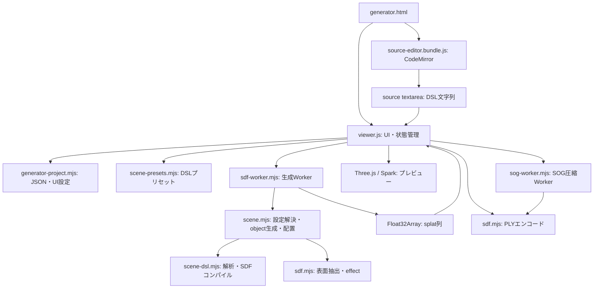

# Generator 実装ガイド

2026-11-13時点のソースに基づく開発者向けドキュメントです。generatorのファイル構成、処理の境界、内部データ形式、機能追加時の変更箇所を説明します。DSLの利用方法は [DSLの書き方](../html/dsl.html)、起動方法は [README](../README.md) を参照してください。

## 1. 全体構成

generatorはブラウザーだけで動作します。メインスレッドが編集・画面表示・保存操作を担当し、SDFからの生成とSOG圧縮を別々のWorkerで実行します。ローカルPythonサーバーは静的ファイルと任意のGPTチャットAPIを提供します。モデル生成・保存は引き続きブラウザー内で完結します。

エントリーポイントは [html/generator.html](../html/generator.html) です。`html/viewer.js` は名前にviewerとありますが、generatorの画面制御です。ファイルビュアーの画面制御は `html/file-viewer.js` です。現在の `html/index.html` の自動遷移先はファイルビュアーなので、generatorへは `/generator.html` を開きます。



生成モジュールはDOM・Three.js・Sparkに依存しません。`scene.mjs` をNode.jsから直接importして生成・テストできます。

## 2. ファイルと責務

| ファイル | 主な責務・公開API |
| --- | --- |
| [html/generator.html](../html/generator.html) | DOM、初期設定値、import map、スクリプト読み込み順。設定・プレビュー・DSLの3ペインを定義 |
| [html/viewer.js](../html/viewer.js) | UIイベント、エディター連携、Workerの生存期間、生成結果、カメラ、プレビュー、各保存操作の統括 |
| [html/generator-project.mjs](../html/generator-project.mjs) | `defaultSettings`、`validateProject`、`parseProject`、`serializeProject`、`projectFilename`、`readSettings`、`applySettings` |
| [html/scene-presets.mjs](../html/scene-presets.mjs) | `scenePresets`。各プリセットは `{ name, source }`。sourceは完成したDSLテキスト |
| [html/sdf-worker.mjs](../html/sdf-worker.mjs) | UIと `generateScene` の通信アダプター。進捗・結果・エラーを返信 |
| [html/scene-dsl.mjs](../html/scene-dsl.mjs) | `parseScene`、`compileDefinitions`、`dslError`。字句解析、構文解析、式のコード生成、参照検査 |
| [html/scene.mjs](../html/scene.mjs) | `sceneDefaults`、`compileScene`、`generateScene`。define参照・継承の解決、設定の正規化、object生成、transform、照明、結合 |
| [html/sdf.mjs](../html/sdf.mjs) | `STRIDE`、`generateSurface`、`effectDefaults`、`encodePly`。格子サンプリングとGaussian生成の本体 |
| [html/sog-worker.mjs](../html/sog-worker.mjs) | 圧縮ライブラリの初期化、座標変換、メモリ上のPLY経由でのSOG出力 |
| [html/splat-resources.mjs](../html/splat-resources.mjs) | `disposeSplatMesh`。Sparkの生成マテリアルを含む旧モデルの解放 |
| [html/render-watchdog.mjs](../html/render-watchdog.mjs) | `RenderWatchdog`。極端に遅い描画を検出してプレビューを停止するための状態管理 |
| [html/display-mode.js](../html/display-mode.js) | generatorとファイルビュアーで共用する全画面・ヘッダー表示操作 |
| [chat-modeling-guide.md](../chat-modeling-guide.md) | チャット用DSL仕様。HTMLリファレンスの内容をMarkdown化し、新しい会話の基本指示として読み込む。DSL変更時はHTMLと同期する |
| [html/dsl.html](../html/dsl.html) | 利用者向けDSLリファレンス。実行処理は持たない静的ページ |
| [editor/source-editor.mjs](../editor/source-editor.mjs) | CodeMirror設定、DSLの色分け・補完、textareaとの同期、`mountSourceEditor` |
| [editor/build.mjs](../editor/build.mjs) | エディターのIIFEバンドルとライセンスファイルを生成 |
| [server/server.py](../server/server.py) | `html/` のHTTP/HTTPS配信、証明書管理、同一オリジンのチャットAPI |
| [server/codex_bridge.py](../server/codex_bridge.py) | CAD由来のCodex stdioブリッジ。`chat-modeling-guide.md` を指示に使用 |
| [html/chat.js](../html/chat.js) | 接続可否に応じた表示、会話・画像、DSL反映、競合保留、undo、自動修正 |
| [scripts/serve.mjs](../scripts/serve.mjs) | Pythonサーバーを起動する互換入口 |

スタイルは `viewer.css` が共通の基礎、`header.css` がヘッダーと全画面操作、`generator.css` がgenerator固有の3ペイン配置とCodeMirrorの調整です。後から読み込む `generator.css` がgeneratorのレイアウトを上書きします。800px以下では設定列＋右側上下ペイン、520px以下では縦3段へ切り替えます。

`sdf.mjs` には旧JavaScript形式用の `presets` と `compileSdf` も残っています。これらは低レベルのSDFテストで使用しており、現在のgenerator UIと生成Workerは呼び出しません。UI側のプリセットは `scene-presets.mjs` を変更します。

テディベアの `scenePresets.teddy.source` と [html/samples/teddy-bear.json](../html/samples/teddy-bear.json) のsourceは同じDSLを保持します。配色は `bearCoat`、`creamCoat` とその派生定義、毛は `bearFur`、`patchFur`、毛なしは `smoothSurface` に共通化しています。腹の毛の長さや口元・鼻・結び目の色などの差分はobject側で上書きします。サンプルを変更する場合は両方のsourceを同期してください。

## 3. 編集・JSON・UI設定

### 3.1 エディターの接続

`generator.html` は、通常スクリプトの `source-editor.bundle.js` と、ES moduleの `viewer.js` を読み込みます。バンドルは `globalThis.SplatSourceEditor.mount` を公開し、`viewer.js` が `mount(source, onGenerate)` を呼びます。

CodeMirrorの編集結果は、更新リスナーが `#source` のtextareaへ書き戻し、`input` イベントを発火します。生成とJSON保存はこのtextareaの `value` を読みます。プリセット選択・JSON読み込みでは `setSource` 経由でエディターとtextareaの両方を更新します。CodeMirrorを使う場合、textareaの値だけを書き換えてもエディター表示は追従しません。

`mountSourceEditor` の戻り値は `{ setValue(value) }` です。`setValue` はEditorStateを作り直すため、文書の入れ替え時に編集履歴も作り直します。バンドルが読み込めない場合はtextareaで編集できます。

エディターはStreamLanguageによる色分け・語彙の補完を提供します。生成用パーサーとは独立しており、DSLの意味検査やエラーの行内表示は行いません。生成はCtrl/⌘+Enter、検索はCodeMirrorの基本設定、Tabはインデントのキーバインドで処理します。

### 3.2 UI設定と単位

`readSettings(byId)` は画面の設定を平坦なオブジェクトに変換します。`secondaryRatio` だけは画面の0〜100%を0〜1へ変換します。`applySettings(settings, byId)` は逆変換します。エフェクトの種類は文字列、下地の有無はチェック状態のbooleanで読み書きします。左ペイン末尾にエフェクトの全デフォルト項目を配置し、DSLで指定した項目を優先します。角度は度、色は `#RRGGBB`、探索範囲・毛の寸法はSDFと同じ単位です。

既定値を持つ場所は次のとおりです。

| 場所 | 用途 |
| --- | --- |
| `generator.html` のinput初期値 | 初回表示のUI |
| `generator-project.mjs: defaultSettings` | 保存・復元するUI項目と、その値の定義 |
| `scene.mjs: sceneDefaults` | UIなしで呼ぶ場合も使う、effectを含めた生成の既定値 |
| `sdf.mjs` の引数既定値・`effectDefaults` | 低レベルAPIを直接呼ぶ場合の既定値 |

値や範囲を変更する際は、これらと各モジュールの検証範囲の整合を確認します。

### 3.3 JSONプロジェクト

JSONの構造は次のとおりです。`defaults` は `defaultSettings` の全項目を持つオブジェクトです。エフェクト項目がない従来のversion 1 JSONは、その項目を初期値で補って読み込みます。指定済みの不正値はエラーにします。

```js
{
  format: "sdf-splat-studio",
  version: 1,
  source: "DSLテキスト",
  defaults: { /* UIの全設定。secondaryRatioは0〜1 */ },
  name: "保存名"
}
```

`parseProject` はBOMを除去してJSONを解析し、`validateProject` が形式・バージョン・設定を検証します。既知のフィールドだけで新しいオブジェクトを作り、未知の追加フィールドは引き継ぎません。defaultsの既知の項目は省略できません。nameは省略可能で、戻り値では空文字になります。

読み込みは全体の検証に成功してからUIへ反映します。読み込んだDSLをその場でコンパイル・生成する処理はなく、「スプラットを生成」で反映します。空文字や構文エラーを含むDSLでも、文字列としての条件を満たせばJSONに保存できます。生成済みsplat、カメラ、描画状態はJSONに含めません。

ファイルサイズ2,000,000 bytesの制限は `viewer.js` のファイル読み込み処理にあります。`parseProject` 自体はこのファイルサイズ制限を持ちません。sourceは100,000文字以内、nameは255文字以内です。`serializeProject` は検証後にインデント付きJSON＋末尾改行を返します。

`projectFilename` はJSON・PLY・SOGで共用し、既存の拡張子やファイル名に使えない文字を処理します。JSONは編集内容を保存し、PLY/SOGは最後に生成に成功した結果を保存する点に注意してください。

## 4. DSL解析とコンパイル

### 4.1 `parseScene(source)`

`scene-dsl.mjs` の内部 `tokenize` が、数値・識別子・ダブルクォート文字列・記号を行/列付きトークンへ分解します。空白と2種類のコメントを読み飛ばし、未対応の文字を検出します。

構文解析は再帰下降で宣言・ブロックを処理し、式は演算子の優先順位を使って解析します。べき乗は右結合、ほかの二項演算子は左結合です。括弧、配列、単項演算、関数呼び出し、条件式を扱います。

戻り値は次の内部ASTです。

| フィールド | 内容 |
| --- | --- |
| `constants` | トップレベルのlet。`{ name, value, token }` の配列 |
| `sdfs` | SDF名をキーとするMap。引数、ローカルlet、return式、位置情報 |
| `defines` | define名をキーとするMap。値は設定エントリー。設定の参照・継承はこの段階では未解決 |
| `objects` | 宣言順の `{ name, token, entries }` の配列 |
| `defaults`, `lighting` | 設定エントリー。省略時は `{ block: new Map() }` |
| `seed` | 共通シードの式と位置情報。省略時はundefined |

設定Mapの要素とdefineの本体は、次の設定エントリーで表します。`block` は設定名をキーとするMapです。

| 構文 | 設定エントリー |
| --- | --- |
| `splat { ... }` / `define coat { ... }` | `{ block, token }` |
| `splat = coat;` / `define alias = coat;` | `{ value, token }`。valueは名前の式ノード |
| `splat coat { ... }` / `define paleCoat coat { ... }` | `{ block, reference, token }`。referenceは参照名のトークン |

`blockEntry` がこの3形式を解析します。通常の `color = "#ffffff";` なども `{ value, token }` です。ブロックの参照か設定値の式かは、後段で使用箇所に応じて判断します。式ノードのtypeは `literal`、`name`、`array`、`unary`、`binary`、`conditional`、`call` です。

`version 1;` は省略可能ですが、書く場合は1のみを受け付けます。sceneは1つ、objectは1つ以上が必要です。SDFの引数は3つで、本体はローカルletの列と最後のreturnで構成します。

defineはトップレベルで宣言し、名前の重複は構文解析時に拒否します。定数・SDFとは別の名前空間を持ち、定義順に依存せず参照できます。DSLとJSONのversionは1のままです。

### 4.2 `compileDefinitions(ast)`

トップレベルletを順番に評価し、各SDFのASTをJavaScript関数へコンパイルして `{ functions, evaluate }` を返します。`functions` はSDF名で参照するオブジェクト、`evaluate(node)` は設定値などの定数式を評価する関数です。

この関数名のDefinitionsは定数とSDFを指し、`define` の設定展開は行いません。define内の値の式も、使用時に同じ `evaluate` で評価します。

コード生成では、引数を `p0`〜`p2`、ローカル変数を `v0`〜へ割り当てます。関数参照は組み込み関数テーブル `b` とユーザーSDFテーブル `f` に限定します。入力のソース全体をJavaScriptとして実行せず、検証したASTから式を組み立てます。ただし、その生成コードを関数化するため内部では `new Function` を使っています。配信環境のCSPを設定する場合は動的コード生成との整合が必要です。

組み込み関数の種類・引数数、名前解決、重複宣言を検査します。定数は先に定義した定数を参照でき、SDF同士は前方参照できます。SDFの呼び出し依存を探索し、直接・間接再帰と32段を超える呼び出しを拒否します。

完全な静的型検査はありません。設定値は後段のスキーマで検証し、SDFの戻り値はサンプリング時に有限数であることを検査します。ベクトルは配列ですが、ベクトルの成分演算・添字アクセス専用の構文はありません。

## 5. sceneの設定解決と生成

### 5.1 `compileScene(source, uiDefaults = {})`

解析・関数化に続き、`scene.mjs` が設定ブロックを検証して、生成できるobjectの配列を返します。

内部の `definition`、`group`、`merge` がdefineを解決します。`definition` は名前を `ast.defines` から探し、解決中の名前をSetで追跡して直接・間接の循環を拒否します。未定義名と循環は参照トークンの行・列付きエラーになります。使用されない定義も参照解決するため、未定義参照・循環を検出します。ただし設定名・値のスキーマ検証は、実際に使うブロックの文脈で行います。

`group` はインラインブロック・名前参照・参照＋上書きを設定Mapへ正規化し、`merge` はブロック同士を再帰的にマージします。未指定の項目は参照先から継承し、明示した値だけ置き換えます。解決済み定義はMapにキャッシュし、正規化済みブロックはWeakSetで管理して再展開を避けます。キャッシュは `compileScene` の呼び出し内でのみ有効です。

参照構文は `sampling`、`splat`、`effect`、`lighting`、`transform`、照明内の `main`・`fill`、scene直下の `defaults`・`lighting` で使えます。たとえば `defaults = bearStyle;` で複数の設定ブロックをまとめて継承できます。各参照では、参照先の設定へローカルの上書きを適用してから、下記のscene/object間の優先順位を適用します。

```js
{ objects: [{ name, token, sdf, options, transform }] }
```

`options` は `generateSurface` が使う平坦な設定です。DSLの `effect.type` は `effect`、`effect.length` は `hairLength`、`effect.width` は `hairWidth` に変換します。未知の項目、値の型・範囲、shape参照、transformの要素数を検査します。

設定は項目単位で次の順番に上書きします。

```text
sceneDefaults
  → UIから渡されたuiDefaults
  → scene直下のlighting
  → scene.defaults内の各ブロック
  → object内の各ブロック
```

共通シードはUI値を `scene.seed` で上書きします。objectでseedを明示した場合はその値を使い、省略した場合は共通シードとobject名を32bit整数演算でハッシュし、0〜1,000,000へ収めます。objectの宣言順はハッシュに含めないため、並べ替えでそのobjectの乱数配置は変わりません。

transformの初期値はposition/rotationが `[0,0,0]`、scaleが1です。scaleは正の数値だけを受け付けます。

### 5.2 `generateScene(source, defaults = {}, onProgress = () => {})`

1. `compileScene` で全objectの設定を解決する。
2. 宣言順に `onProgress({ name, index, total })` を呼ぶ。indexは0始まり。
3. `generateSurface(sdf, options, { deferLighting: true, maxSplats: 残り個数 })` でローカル座標のsplatを生成する。
4. 中心位置、法線、Gaussianのquaternionを回転し、位置と標準偏差を一様拡大し、中心位置を移動する。
5. ワールド座標の法線から照明を計算してRGBへ乗算する。
6. 境界と統計を更新し、objectごとの配列を最後に1本のFloat32Arrayへ結合する。

回転はEuler XYZから `q = qx * qy * qz` を作ります。Gaussianの向きは `q * ローカルquaternion`、位置は `scale * rotate(position) + translation` です。毛も先に生成してからまとめて変換するため、scaleを変えると毛の長さ・太さも拡大されます。密度はローカル座標の面積を基準にします。

照明は環境光＋メイン方向光＋固定方向の補助光を0〜1の明るさにまとめます。effectの法線フィールドには毛の根元の外向き法線を保持しており、毛のGaussianの長軸方向とは異なる場合があります。

各objectは独立に生成します。重なるobjectの内部表面の除去、object間のCSG、影、相互の遮蔽計算はありません。SDF内でCSGした形状は1つのobjectとしてサンプリングされ、1組の設定を適用します。

## 6. SDFから表面とeffectを作る

### 6.1 `generateSurface(sdf, options, executionOptions)`

`sdf.mjs` の低レベルAPIです。`sdf(x,y,z)` は負が内部・0が表面・正が外部の有限数を返す必要があります。

探索範囲は各軸 `[-extent,+extent]`、分割数はresolutionです。セル幅は `step = 2 * extent / resolution`、格子は `(resolution+1)^3` 要素のFloat64Arrayです。

各セルで8頂点の符号を調べ、12辺の符号変化点を線形補間し、その平均を表面の候補点にします。SDFの差分勾配でゼロ面へ最大4回補正し、法線と、ローカルZ軸を法線へ向けるquaternionを計算します。三角形メッシュは作らず、有効な交差セルから下地のsplatを1個ずつ作ります。

下地の標準偏差は `[step*size, step*size, step*size*thickness]`、alphaは0.92です。境界格子で距離が0以下なら `clipped` を立てます。細かすぎる形状や、格子頂点で符号変化を拾えない面は検出できない場合があります。

`executionOptions.deferLighting` がfalseの通常呼び出しでは、この段階で照明を焼き込みます。scene経由ではtrueにし、白い下地を使って後段に照明計算を延期します。色の選択とeffect内の明暗は延期しません。

### 6.2 内部 `addEffect`

下地から毛・房の根元を作ります。セルの推定面積を `step^2 / (abs(nx)+abs(ny)+abs(nz))` としてdensityを掛け、整数分と確率的な端数分から本数を決めます。根元を接平面内でずらし、SDFへ最大3回再投影します。

| effect | 生成方法 |
| --- | --- |
| `none` | 下地だけを出力。baseの値にかかわらず下地を表示 |
| `fur` | 根元1つから3個のGaussianを作り、先端ほど細くする。alphaは0.88 |
| `fluffy` | 根元1つから1個の楕円体を作る。alphaは0.8 |

毛束の傾きは連続したsinの空間場と乱数を組み合わせます。長さ・太さにはvariation、方向にはdisorderとclumpを適用します。毛のRGBには位置に応じた `0.75 + 0.25*t` の係数も掛けます。物理シミュレーションは行いません。

`base=false` なら下地のsplatを最終出力から外しますが、根元を作るための下地サンプリングは必要です。`surfaceCount` は出力に下地を残したかどうかに関係なく、抽出した下地点数です。`hairCount` は毛・房の根元数で、furの最終splat数とは3倍の差があります。

### 6.3 配色と乱数

effect生成後の各splatについて、secondaryRatioの確率で補助色を選び、それ以外はベース色を選びます。色の補間ではありません。毛の配置と配色には、同じseedから開始する別々の線形合同法の乱数系列を使います。配色の割合を変更しても毛の形状を決める系列は進みません。

## 7. splatの内部形式と結果

`STRIDE = 17`。1個のsplatを17個のFloat32、68 bytesで表します。splat番号iの先頭は `i * STRIDE` です。

| オフセット | 内容 | 規約 |
| --- | --- | --- |
| 0〜2 | 中心x/y/z | scene結果はワールド座標、Y-up |
| 3〜5 | 法線nx/ny/nz | 照明・PLY用。毛の場合は根元の外向き法線 |
| 6〜9 | quaternion x/y/z/w | Gaussianの向き。PLYの並びとは異なる |
| 10〜12 | RGB | 配色・effectの明暗・照明が反映された色 |
| 13 | alpha | 確率値。PLY出力時にlogitへ変換 |
| 14〜16 | scale x/y/z | Gaussianの各軸の標準偏差。直径ではない |

`generateScene` の戻り値は次の形です。

```js
{
  data,            // Float32Array。length === count * STRIDE
  count,           // 下地とeffectを含む最終splat数
  hairCount,       // 毛・房の根元数の合計
  surfaceCount,    // effect適用前に抽出した下地点数の合計
  min, max,        // 各軸の境界。number[3]
  clipped,         // いずれかのobjectが探索範囲の境界に達したか
  objects: [{ name, offset, count, hairCount, clipped }],
  elapsed          // DSLコンパイル開始から結合完了までのms
}
```

objectのoffsetはsplat数単位です。float配列の範囲を取り出す場合は `offset * STRIDE` を使います。境界は各splatの中心から `3 * max(scale)` を各軸に広げた保守的な範囲です。

`generateSurface` 単体はobjectsを持たず、下地の代表サイズ `scales` を追加で返します。scene結果とeffectの個々のサイズはdata内を参照します。elapsedは生成時間で、Worker起動、通信、Spark初期化や描画時間を含みません。

## 8. Worker通信と状態の生存期間

### 8.1 生成Worker

`sampleInWorker` は生成ごとに新しいmodule Workerを作成します。

| 方向 | メッセージ |
| --- | --- |
| UI → Worker | `{ source, options }` |
| Worker → UI・途中 | `{ progress: { name, index, total } }` |
| Worker → UI・成功 | `{ result }`。`result.data.buffer` をtransfer |
| Worker → UI・失敗 | `{ error: エラー文字列 }` |

エラーは `dslError` が行・列を持つErrorを作りますが、Workerの返信はmessage文字列だけです。構文・設定エラーは該当トークンの位置、生成中の例外はobject宣言の位置とobject名を付けて報告します。

成功・失敗・30秒タイムアウト・AbortSignalによる中止のどの場合もWorkerをterminateします。同期ループ内でキャンセルを検査する方式ではありません。30秒の上限は `viewer.js` が保証し、Node.jsなどから直接 `generateScene` を呼ぶ場合は時間制限が付きません。

Workerから転送したバッファーはUI側が所有します。生成失敗時はUI側のresultを置き換えないため、直前の結果の表示・保存を継続できます。

### 8.2 表示の差し替え

`display(next)` は新しいSplatMeshを作り、初期化と全splatの転送数を確認した後で旧モデルを解放します。新モデルの初期化に失敗した場合は、新モデルを解放して例外にします。

成功時に `result`、`model`、`bounds` を更新します。カメラを全体へ合わせるのは初回と視点リセット時で、再生成ではカメラを維持します。点群表示は同じdataから `THREE.Points` を必要になった時点で作り、再生成時にgeometryとmaterialを解放します。

`disposeSplatMesh` はmesh自身のdisposeに加えて、Spark 2.4.0の `SplatAccumulator.generatorProgram` キャッシュからgenerator/covGeneratorのマテリアルを解放します。Spark内部APIに依存するため、Sparkを更新する際はこの処理とテストを確認します。

### 8.3 描画停止

`RenderWatchdog.sample(start,end)` は描画関数の所要時間とフレーム開始間隔の大きい方を評価します。3秒以上の1フレーム、または500ms以上が3回連続すると停止状態になります。

非表示タブでは描画ループを止め、復帰時に計測をリセットします。生成中も計測をリセットし、生成・初期化の遅さを描画の停止判定へ持ち込みません。watchdogが停止した場合、タブ復帰だけでは再開せず、再生成成功時に `reset()` して再開します。停止してもresultは保持します。

## 9. 出力処理

### 9.1 PLY

`encodePly({ data, count })` は `Uint8Array` を返します。binary little-endian、1レコード17個のfloatで、プロパティ順は次のとおりです。

```text
x y z nx ny nz f_dc_0 f_dc_1 f_dc_2
opacity scale_0 scale_1 scale_2 rot_0 rot_1 rot_2 rot_3
```

RGBは `(channel - 0.5) / 0.28209479177387814` でSH0係数へ、alphaは `log(alpha/(1-alpha))`、各scaleは対数へ変換します。quaternionは内部のXYZWからPLYのWXYZへ並べ替えます。座標はY-upを保ちます。現在は高次SHを生成せず、明暗をSH0へ焼き付けます。

### 9.2 SOG

SOG Workerは起動時にSplatTransform 3.10.3とWebP WASMをCDNから読み込みます。SH0の変換なのでライブラリの `WorkerQueue.maxWorkers = 0` とし、このWorker内のCPU処理を使います。

| 方向 | メッセージ |
| --- | --- |
| Worker → UI・準備完了 | `{ type: "ready" }` |
| Worker → UI・準備失敗 | `{ type: "unavailable", message }` |
| UI → Worker・変換 | `{ data, count }`。コピーしたdataのbufferをtransfer |
| Worker → UI・成功 | `{ type: "result", bytes }`。bytesのbufferをtransfer |
| Worker → UI・変換失敗 | `{ type: "error", message }` |

UIは `result.data.slice()` を渡します。Worker内ではこのコピーをX軸180度回転相当の座標へ変換し、メモリ上でPLYを作成、ライブラリで読み直して `sog-bundle` を出力します。SOG読込側の座標規約に合わせる処理なので、元のプレビュー・PLY用データへ適用しません。

Workerは変換間で再利用し、ライブラリのsourceは処理後にcloseします。準備に60秒、変換に120秒のタイムアウトがあります。失敗時はSOG機能を無効化し、再読み込みで再試行します。圧縮中は再生成を止めますが、プレビュー操作とPLY保存は続けられます。

## 10. 上限とコスト

| 対象 | 現在の上限・動作 | 実装箇所 |
| --- | --- | --- |
| DSL長 | 100,000文字 | `scene-dsl.mjs`、JSONのsource検証 |
| 式の再帰的な解析深度 | 64 | `scene-dsl.mjs: expression` |
| 設定ブロックの入れ子 | 16 | `scene-dsl.mjs: block` |
| define・設定の解決 | `group` の再帰深度が32を超えると拒否。循環参照不可。解決済みの定義・ブロックは再展開しない | `scene.mjs: definition/group` |
| SDF呼び出し依存の深さ | 32。再帰不可 | `compileDefinitions` |
| 分割数 | 各軸16〜144 | UI、scene・SDF・JSONの検証 |
| 下地の抽出数 | object単体で500,000以下 | `generateSurface` |
| 最終出力数 | scene合計500,000以下 | `generateScene` と `addEffect` |
| 生成時間 | UI経由では30秒 | `sampleInWorker` |

格子の走査・メモリは分割数nに対しておおむねO(n³)です。SDF呼び出しには式とCSGの計算コストが加わります。法線計算と表面補正、毛の根元の再投影でもSDFを呼びます。同じSDFを複数objectから参照しても、生成結果や格子のキャッシュはありません。

最終splat配列は50万個で約34 MBですが、生成途中の下地・effect配列、object別配列と結合先、SOG保存用コピー、PLY、GPU側のデータは別に必要です。格子のFloat64Arrayは最大分割数で約24.4 MBです。objectは順次生成しますが、最終結合まで各objectの出力配列を保持します。

## 11. 開発・拡張時の変更箇所

通常の配信には `html/` の配置だけでよく、エディターのビルド成果物も同梱しています。エディターを変更する場合はリポジトリルートで実行します。

```sh
npm ci
npm run build:editor
```

`editor/build.mjs` はCodeMirrorをIIFEへまとめ、`html/source-editor.bundle.js` と `html/source-editor.bundle.LICENSE.txt` を生成します。UIWのライセンスは `editor/licenses/uiw-4.25.12.txt` を使います。生成済みバンドルの直接編集は避け、ソースから再ビルドします。

| 変更したい機能 | 主な変更箇所と確認事項 |
| --- | --- |
| SDFの組み込み関数 | `scene-dsl.mjs` のbuiltinsと引数数、エディターのfunctions、DSLヘルプ、sceneテスト |
| 新しい構文・演算子 | tokenize、expression/parseScene、ASTのcode生成、エディターの色分け、構文のテスト |
| define・設定ブロックの参照 | `scene-dsl.mjs` のblockEntry/defines、`scene.mjs` のdefinition/group/merge。ブロックの種類を追加する場合はblockNamesとスキーマ処理も更新 |
| 新しいsplat/effectパラメータ | sceneの設定名マッピング・範囲、SDFの検証と生成、ヘルプ、生成テスト |
| UIのデフォルト項目 | HTML、projectのdefaultSettings/ranges、sceneDefaults、保存・復元テスト。既存JSONとの互換性も検討 |
| effectの種類 | effect種別の検証、addEffect、裸のenumの許可、sceneDefaults、エディター、ヘルプ、プリセット |
| プリセット | `scene-presets.mjs`。UIから継承させる値はDSLへ固定値を書かない。JSONサンプルがある場合はsourceを同期 |
| 内部splat形式 | STRIDEと全生成処理、scene変換、Spark/点群構築、PLY、SOG座標変換、関連テストを一緒に変更 |
| Sparkのバージョン | HTMLのimport map、SplatMesh初期化、splat-resourcesの内部API依存、ブラウザー表示 |
| SOGライブラリ | Worker内のESM/WASMの両URL、ライブラリAPI、出力の座標系と読込互換性 |

## 12. テストと確認範囲

テストはNode.js標準のtest runnerを使います。

```sh
npm test
```

| テスト | 対象 |
| --- | --- |
| [test/scene.test.mjs](../test/scene.test.mjs) | プリセット、式、設定継承、define参照・派生・別名・前方参照・入れ子の上書き、直書きとの生成データ一致、未定義・循環・深さ・使用文脈の検証、object別の色・effect、乱数の再現性、transform、照明、エラー、scene全体の上限 |
| [test/sdf.test.mjs](../test/sdf.test.mjs) | ゼロ面と法線、トーラスの穴、境界、配色、照明、PLY、毛の向き・寸法、密度、effectの再現性 |
| [test/generator-project.test.mjs](../test/generator-project.test.mjs) | JSON往復、入力検証、設定復元、割合の単位、ファイル名処理 |
| [test/splat-resources.test.mjs](../test/splat-resources.test.mjs) | 生成マテリアルとmeshの解放手順 |
| [test/render-watchdog.test.mjs](../test/render-watchdog.test.mjs) | 遅いフレームの検出と停止・復帰の状態 |
| [test/server.test.mjs](../test/server.test.mjs) | 静的配信、HTTP/HTTPS、証明書、非公開ファイルの保護 |

これらはGPU描画、CodeMirrorの実操作、ブラウザーWorkerとダウンロード、CDNからのSOG変換を直接検証するテストではありません。その範囲を変更する場合は、ブラウザーでも生成・再生成・中止、エディター同期、点群切り替え、JSON往復、PLY/SOG保存を確認します。`test/xr-gestures.test.mjs` はファイルビュアー側のXR操作を対象とし、generatorの生成経路には入りません。
